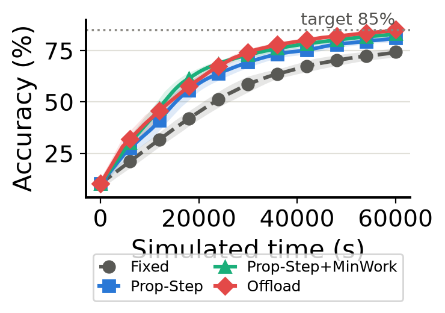

# LH-FL 후속 연구: Local-Step 조절을 통한 Offloading-Free Straggler 완화

**연구 요약 — 지도교수 보고용**
데이터: EuroSAT (ResNet18 임베딩, 512-d) · 220위성/10궤도면 Starlink-like 구성 · Dirichlet(α=0.5) 비IID 분할 · 10-seed(0~9) · 60,000초(1000분) 예산 · 목표 정확도 85%
전체 그래프/표: [`report/`](report/) 폴더 (생성 코드: [`make_report.py`](make_report.py)) · 엔진/구현 세부사항: [`README.md`](README.md)

---

## 1. 연구 동기

기존 LH-FL(leader-based hierarchical federated learning)은 위성 간 계산 능력(capacity) 편차로 인한 **straggler(느린 위성) 문제**를 **학습 시작 전 1회 데이터 재분배(one-shot offloading)**로 완화한다:

```
n_i' = (C_i / ΣC_j) × Σn_j        (fl_core.offload_within_plane)
```

느린 위성의 데이터 일부를 빠른 위성으로 옮겨, 위성별 "데이터량/계산능력" 비율을 평준화하는 방식이다. 이 방식은 효과적이지만 다음과 같은 **구조적 한계**를 가진다:

- **프라이버시 노출**: 원본 데이터(혹은 이번 실험처럼 ResNet18 임베딩)가 위성 경계를 넘어 이동한다. 임베딩이라도 역변환(embedding inversion) 공격을 통해 원본 정보가 재구성될 위험이 알려져 있다.
- **통신 비용**: 모델 파라미터 교환과 별개로, 학습 샘플 자체를 옮기는 추가 통신이 필요하다.
- **Trusted-domain 가정**: 위성 간에 원본/임베딩 데이터를 주고받으려면, 모델 파라미터만 교환하는 경우보다 **더 강한 신뢰 관계**(동일 운영자 또는 상호 신뢰 도메인)가 전제되어야 한다.
- **접촉 제약 하 전송 불확실성**: 위성 간 통신 기회(ISL 접촉)가 제한적인 환경에서, 학습 전 1회성 대용량 데이터 전송 자체가 완료되지 못할 위험이 있다(반면 모델 파라미터 교환은 상대적으로 가볍고 반복적이라 재시도가 쉽다).

**제안**: 데이터는 각 위성에 그대로 두고, **local step 수를 위성의 계산 능력에 비례해 조절**하여 동일한 straggler 완화 효과를 데이터 이동 없이 얻을 수 있는지 검증한다.

---

## 2. 방법

네 가지 방법을 **동일한 엔진** 위에서 비교한다 — optimizer(vanilla SGD, momentum=0), 집계 방식(FedNova), 동기화 배리어(기존 LH-FL의 전체-위성망 배리어 그대로 재현), 리더 구조·리더 간 모델 혼합이 **전부 동일**하고, 오직 **"학습 전 데이터를 옮기는가"만 다른 단일 변수 비교**다.

| 방법 | step 수 결정 | 데이터 이동 |
|---|---|---|
| **fixed** (baseline) | 모든 위성 동일 step 수 (완화 없음) | 없음 |
| **Proportional-Step** | `step_i = round((C_i/ΣC_j) × S_total)`, `S_total = fixed_steps × 궤도면 위성 수` — offloading 공식의 **step 버전**(n_i' 자리에 step_i, 데이터총량 자리에 step 총예산) | 없음 |
| **Proportional-Step + MinWork** | `Proportional-Step`의 배분값을 `minimum_steps_i = max(1, ceil(fraction × steps_per_epoch_i))`로 하한 보장 | 없음 |
| **offload** | `Proportional-Step`와 동일하지만, 학습 시작 전 **기존 offloading 공식 그대로**(`offload_within_plane`, 기존 코드 그대로 재사용) 1회 데이터 재분배 후 고정 step 수로 학습 | **있음** (공정 비교용으로 동일 엔진 안에 재현) |

**FedNova의 역할**: Proportional-Step/Proportional-Step+MinWork는 위성마다 실제 수행한 step 수(τ_i)가 다르다. 단순 평균은 "step이 다르면 각자의 로컬 업데이트가 서로 다른 유효 학습률로 수렴한다"는 점을 무시해 편향을 유발한다. FedNova는 각 위성의 모델 변화량을 자신의 τ_i로 정규화한 뒤 데이터 비율로 가중합하여 이 편향을 보정한다 — τ_i가 모두 같으면(= fixed, offload) 단순 가중평균(FedAvg)과 수학적으로 동일함을 유닛테스트로 검증했다.

---

## 3. 결과 (10-seed, 있는 그대로)



| 방법 | 최종 정확도 (mean±std) | 85% 도달 | slow-subgroup recall | 통신량 (MB) |
|---|---|---|---|---|
| fixed | 74.39 ± 2.55% | 0/10 | 0.688 ± 0.155 | 40.33 ± 3.35 |
| Proportional-Step | 81.01 ± 1.79% | 0/10 | 0.789 ± 0.094 | 64.42 ± 5.26 |
| Proportional-Step + MinWork (1.0) | 83.12 ± 1.11% | 1/10 | 0.812 ± 0.087 | 64.42 ± 5.26 |
| **offload** | **85.14 ± 0.74%** | **6/10** | **0.849 ± 0.051** | 74.96 ± 0.19 |

**핵심 수치**: fixed(74.4%) < Proportional-Step(81.0%) < Proportional-Step+MinWork(83.1%) < offload(85.1%).

- **step 조절만으로(데이터 이동 없이) baseline 대비 +6.6%p(Proportional-Step) ~ +8.7%p(Proportional-Step+MinWork) 개선**. straggler 완화 효과가 분명하다.
- **그러나 제안 방법(Proportional-Step+MinWork)은 offload를 이기지 못한다.** offload가 10-seed 전체에서 정확도·85% 도달률·slow-subgroup recall 전부 1위다. 이 결과를 왜곡하지 않고 그대로 보고한다.
- **통신량**: Proportional-Step/Proportional-Step+MinWork(64.4MB)가 offload(75.0MB)보다 약 **14% 적다**. 단, 이 차이의 대부분(~85%)은 데이터 이동 자체의 비용(seed당 약 1.3~1.9MB, 전체의 2% 수준)이 아니라 **offload가 더 빨리 수렴해 모델 교환 cycle을 더 많이 돌았기 때문**이다 — "데이터 이동이 통신을 늘린다"가 아니라 "더 활발한 학습이 통신도 늘린다"는 점을 분명히 해야 한다.
- **slow-subgroup recall 및 macro F1 격차**: 전체 정확도와 macro F1의 차이(소수 클래스 희생 정도)가 fixed 3.74%p → Proportional-Step 1.72%p → Proportional-Step+MinWork(1.0) 1.30%p → offload 0.96%p로 **완화가 강해질수록 단조적으로 감소**한다. 전체 정확도만 보면 과소평가되는 "약자 보호" 효과가 이 지표로 드러난다.
- **fraction(0.1~1.0) trade-off**: [`report/fig4_fraction_tradeoff.png`](report/fig4_fraction_tradeoff.png). 0.1, 0.25는 이 데이터 스케일(위성당 데이터가 적어 `steps_per_epoch` 중앙값=3)에서 **Proportional-Step과 완전히 동일한 step 배분이 되어 사실상 no-op**이다(10/10, 8/10 seed에서 step이 bit-identical로 확인됨). 실질적 효과는 fraction≥0.5부터 나타나며, 0.5→1.0 구간에서 정확도·slow-subgroup recall 모두 단조 증가한다.

---

## 4. 해석 / 포지셔닝 (가장 중요)

**제안의 가치는 "offload를 이긴다"가 아니다.** 10-seed 결과는 명확히 offload가 가장 우수함을 보여준다. 제안의 가치는 다음과 같이 정직하게 포지셔닝해야 한다:

> **데이터를 전혀 옮기지 않고도, step 조절만으로 offload가 베이스라인 대비 만드는 개선분의 약 81%를 회수한다.**
> (fixed→offload 전체 개선폭 10.75%p 중, fixed→Proportional-Step+MinWork(1.0) 개선폭 8.73%p = **81.2%**. Proportional-Step 단독만으로도 61.6%를 회수한다.)

**offload가 더 우수한 이유**: offloading은 학습이 시작되기 전에 "데이터량/계산능력" 비율 자체를 물리적으로 평준화한다 — 느린 위성은 데이터를 **덜 갖게 되어**, 같은 시간 예산 안에서도 자기 데이터를 상대적으로 더 완전히 학습할 수 있다. 반면 step 조절은 데이터량은 그대로 둔 채 step 수만 조절하므로, 원래 데이터가 많았던 느린 위성은 여전히 많은 데이터를 가진 채 더 적은 step만 수행하게 되어 **자기 데이터에 대한 커버리지(epoch 완성도)는 offload만큼 올라가지 않는다.** 이는 slow-subgroup recall이 offload에서 가장 높게 나온 것과도 일치한다.

**실용적 포지셔닝**: 데이터(또는 그 임베딩) 이동이 제약되거나 바람직하지 않은 환경 — 프라이버시에 민감한 영상 데이터, 서로 다른 운영자가 소유한 다중 운영자(multi-operator) 위성망, trusted-domain을 가정하기 어려운 구성, 또는 대역폭이 극히 제한된 ISL 환경 — 에서는 **"offload와 동등한 성능"이 아니라 "데이터 이동 없이 offload 효과의 상당 부분(~81%)을 확보하면서, 통신량은 더 적고(-14%), 원본/임베딩 데이터가 위성 경계를 절대 넘지 않는다는 구조적 보장을 제공하는 실용적 대안"**으로 제시하는 것이 정직하고 방어 가능한 주장이다. 단, 프라이버시 이점은 현재 "데이터가 코드상 절대 이동하지 않는다"는 **구조적 사실**이지, 공격 실험으로 **정량화된 이점은 아니다** — 5절에서 향후 과제로 명시한다.

---

## 5. 한계 / 향후 과제

1. **클래스별(10-class) recall/F1 미보유**: 현재 로그는 macro F1과 "느린 위성 과다보유 클래스 2~3개"에 대한 slow-subgroup recall만 저장되어 있고, 10개 클래스 전체의 개별 recall/F1은 기록되지 않았다(모델 체크포인트도 저장되지 않음). 재학습 없이는 복구 불가 — 로깅을 보강한 재실행이 필요하다.
2. **offload 대비 정확도 격차 축소 여지**: 현재 Proportional-Step 공식은 위성의 "속도(capacity)"만 반영하고 "이미 보유한 데이터량"은 반영하지 않는다. offloading처럼 두 요소를 함께 고려하는 더 정교한 step 배분(예: 데이터량이 많은 느린 위성에 더 공격적인 step 할당)으로 격차를 줄일 수 있는지는 검증되지 않았다.
3. **프라이버시 이점의 정량화 부재**: "데이터가 이동하지 않는다"는 구조적 이점을 embedding inversion 공격 실험 등으로 정량적으로 뒷받침하면 제안의 차별성이 강화된다.
4. **legacy reference(Adam/비가중평균)는 추가 confound 보유**: 본 보고서의 offload 결과는 "공정 비교용으로 동일 엔진에서 재현한 offload"이며, 실제 기존 LH-FL 코드(`legacy_reference.py`, Adam optimizer + 비가중평균 집계)는 이와 별개로 옵티마이저·집계방식·시간모델이 모두 달라 직접 비교 대상이 아니다(참고용 수치만 보유).
5. **단일 데이터셋/모델 구조**: EuroSAT + 고정 DNN head(512→100→100→10) 조합에서만 검증되었다. 다른 데이터 분포·모델 크기에 대한 일반화는 미확인.
6. **단일 예산/목표치**: 60,000초, 목표 85% 조건에서만 10-seed를 확보했다. 다른 시간 예산이나 목표 정확도에서 결과(특히 fraction trade-off의 단조성)가 유지되는지는 미확인.
