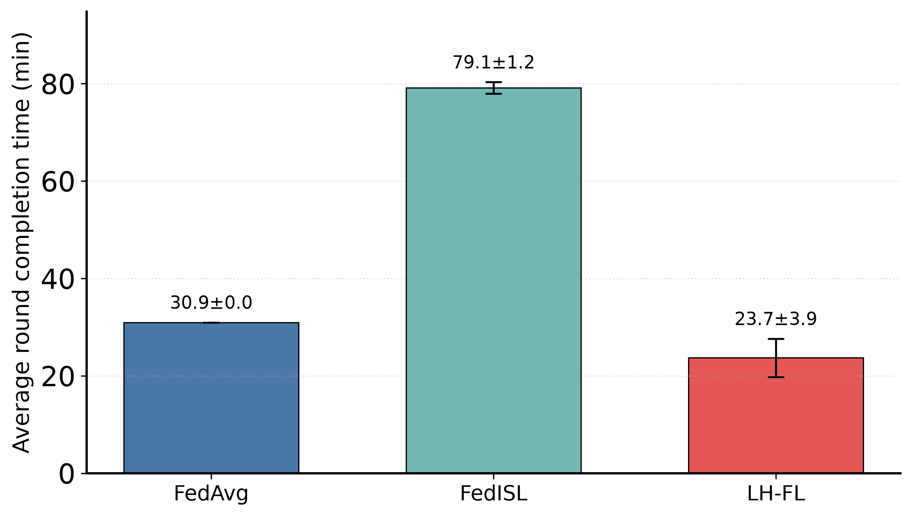
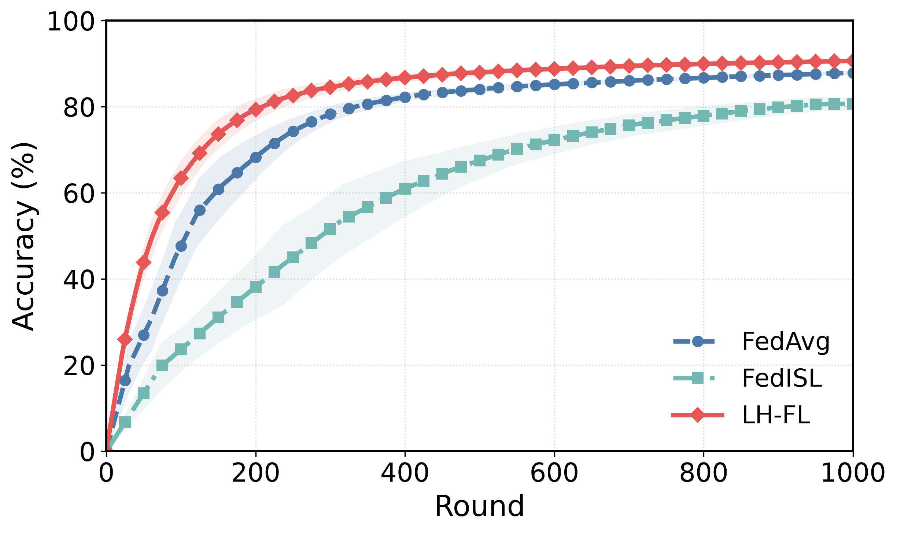
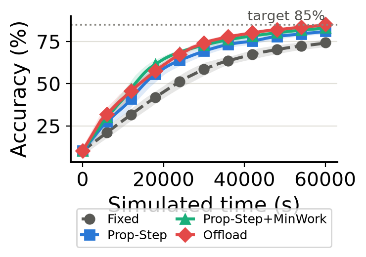

# LeoFL — 저궤도(LEO) 위성군을 위한 리더 기반 계층형 연합학습 시뮬레이터

> 성신여자대학교 INCLab · Federated Learning in LEO Satellite Constellations
> [작성자 확인 필요: 연구 기간, 본인 역할/기여 범위, 지도교수·공동연구자 표기 여부]
> [작성자 확인 필요: MobiSec 2025 포스터 발표 정보(제목·저자·학회명) — 저장소에는 포스터 PDF를 포함하지 않음]

저궤도(LEO) 위성 수백 기가 각자 수집한 데이터를 지상으로 내려보내지 않고, **위성 위에서 모델을 학습하고 모델 파라미터만 교환**하는 연합학습(Federated Learning, FL)을 시뮬레이션하는 Python/PyTorch 프로젝트입니다.

Starlink 유사 궤도 구성(Walker-Delta)에서 위성 간 거리·접촉(ISL)·학습 시간을 시간 단위로 시뮬레이션하고, 그 위에서 **LH-FL(Leader-based Hierarchical FL)** 과 FedAvg · FedISL · FedLEO · 분산(Decentralized) FL 등 비교 기법을 **같은 조건**으로 실행해 정확도·라운드 완료 시간·통신량을 비교합니다.

---

## 목차
1. [배경 및 동기](#1-배경-및-동기)
2. [핵심 아이디어: LH-FL](#2-핵심-아이디어-lh-fl)
3. [아키텍처](#3-아키텍처)
4. [기술 스택](#4-기술-스택)
5. [실행 방법](#5-실행-방법)
6. [결과](#6-결과)
7. [후속 연구: 데이터 이동 없는 straggler 완화](#7-후속-연구-데이터-이동-없는-straggler-완화)
8. [한계 및 향후 계획](#8-한계-및-향후-계획)

---

## 1. 배경 및 동기

위성 영상처럼 위성에서 생성되는 데이터를 모두 지상국으로 내려보내 중앙에서 학습하는 방식은 다운링크 대역폭과 지상국 접촉 시간의 제약을 크게 받습니다. 연합학습은 데이터를 위성에 둔 채 모델만 주고받아 이 문제를 줄일 수 있지만, LEO 환경에는 지상 FL과 다른 어려움이 있습니다.

- **간헐적 연결**: 위성은 지상국(GS)과 짧은 시간만 연결됩니다. GS 중심의 FL(FedAvg, FedISL 등)은 접촉을 기다리는 시간 때문에 라운드가 길어집니다.
- **계산 능력 이질성(straggler)**: 위성마다 학습 속도가 달라, 동기식 집계에서는 가장 느린 위성이 전체 라운드를 지연시킵니다.
- **non-IID 데이터**: 위성마다 관측하는 지역이 달라 데이터 분포가 치우칩니다 (본 실험은 Dirichlet α=0.5 분할).

이 프로젝트는 **같은 궤도면(orbital plane) 위성들은 ISL 링으로 항상 연결되어 있다**는 구조를 활용합니다. 궤도면마다 리더를 두어 궤도면 안에서 먼저 집계하고, 리더끼리 접촉할 때 모델을 섞는 계층형 구조로 GS 의존성과 straggler 문제를 함께 줄이는 것이 목표입니다. 초기 단계의 시나리오 정리는 [`docs/scenarios.md`](docs/scenarios.md)에 있습니다.

## 2. 핵심 아이디어: LH-FL

구현 위치: [`LeoFL/Simulator/scenarios.py`](LeoFL/Simulator/scenarios.py) `OffloadScenario`, 접촉 기반 버전 [`LeoFL/Simulator/scenarios_contact.py`](LeoFL/Simulator/scenarios_contact.py) (메인 실험에서 사용)

1. **계산 능력 추정**: 위성 i의 계산 능력 `C_i ∝ 1 / (에폭당 학습 시간)`.
2. **리더 선출**: 시뮬레이션 구간 동안 위성 쌍의 거리를 계산해 `max_dist_km` 이내면 접촉으로 셉니다. 궤도면마다 **다른 궤도면과 가장 많이 만나는 위성**을 리더로 뽑습니다 (`fl_core.precompute_meetings_and_select_leaders`).
3. **궤도면 내 1회 오프로딩**: 학습 전 한 번, 궤도면 안에서 데이터를 계산 능력에 비례하도록 재분배해 straggler를 완화합니다.
   ```
   n_i' = (C_i / Σ_j C_j) × Σ_j n_j        (fl_core.offload_within_plane)
   ```
4. **사이클 반복**
   - 각 위성이 로컬 학습 → 궤도면 내 집계(FedAvg)
   - **리더 간 혼합**: 리더는 이웃 궤도면 리더 모델과 `w̃_p = (1−β)·w_p + β·mean_q(w_q)` (β=0.5)로 섞습니다. 접촉 기반 버전은 **그 라운드에 실제로 접촉 중인 이웃**과만 섞습니다.
   - 궤도면 모델을 구성원에게 다시 배포합니다.
5. **통신량 기록**: 궤도면 내 hop 수, 리더 간 링크, 오프로딩 데이터를 bytes 단위로 기록합니다 (`comm_Logger.py`).

비교 기법(같은 엔진 위에서 실행):

| 기법 | 요약 |
|---|---|
| FedAvg (`always`) | 모든 위성이 항상 서버와 연결된 이상적 기준선 |
| FedISL | 지상국(PS)이 궤도면별 source 위성에 모델 전달 → 궤도면 ISL 링 전달 → sink가 PS 접촉을 기다려 업로드 |
| FedLEO | greedy 오프로딩 + 협력 쌍 단위 모델 평균 |
| Decentralized | 서버 없이 이웃과 P2P 모델 혼합 |
| Ablation ladder | FedISL·Decentral에 리더 / 혼합 / 오프로딩 요소를 하나씩 추가해 각 구성 요소의 기여를 분리 (`scenarios_fedisl_ladder.py`, `scenarios_fedisl_mixing.py`) |

## 3. 아키텍처

```
LeoFL_INCLab/
├── LeoFL/
│   ├── Simulator/            ★ 메인 FL 시뮬레이터
│   │   ├── fl_core.py            모델(DNN/CNN), non-IID 분할, Walker-Delta/Starlink 위성군, 학습·평가·집계, 오프로딩, SimConfig
│   │   ├── scenarios.py          FedAvg / 간헐 연결 / LH-FL(Offload) / Decentralized / FedLEO / FedISL
│   │   ├── scenarios_contact.py  접촉 기반 LH-FL (메인 실험의 LH-FL)
│   │   ├── scenarios_fedisl_*.py FedISL → LH-FL ablation ladder
│   │   ├── run_simulator.py      mode 문자열 → 시나리오 생성·실행 (단일 진입 함수)
│   │   ├── comm_Logger.py        통신량(bytes/hops) 로거
│   │   └── analysis_utils.py     로그 CSV → 논문용 그래프·multi-seed 요약표
│   ├── EuroSAT/              ★ EuroSAT 메인 실험 + 3D 개요도 스크립트
│   ├── CIFAR10/                CIFAR-10 실험 (CNN)
│   ├── followup/             ★ 후속 연구 패키지 (엔진, FedNova, 정책, 테스트 18개, 리포트)
│   ├── Leo/                    궤도 역학 유틸 (위성 위치, 커버리지, 좌표 변환)
│   ├── FL/                     [legacy] 초기 단일 파일 프로토타입 (UNR-IDD 데이터)
│   └── UNR-IDD/                [legacy] 초기 실험 데이터 위치 (데이터 파일은 미포함)
├── logs_eurosat_3layer/      메인 EuroSAT 실험 로그·요약표·그래프 (현재 코드가 생성)
├── logs_eurosat/             이전 버전(2-layer 모델) EuroSAT 로그
├── logs_eurosat_3layer_linkfail/  링크 실패 변형 실험 로그 [작성자 확인 필요: 생성 스크립트·설정]
├── logs_cifar10/             CIFAR-10 실험 로그
├── logs_followup/            후속 연구 10-seed 로그 (make_report.py 입력)
├── logs/                     [legacy] 초기 UNR-IDD 실험 로그
├── figures/                  LH-FL 동작 개요도 (2D/3D)
├── scripts/compute_tx_time.py  로그 후처리: 링크 대역폭별 전송 지연 반영 라운드 시간
└── docs/scenarios.md         초기 시나리오 설계 문서
```

**시뮬레이션 흐름** (`LeoFL/EuroSAT/simulation_eurosat.py`)

```
EuroSAT 다운로드 → ResNet18(사전학습)로 512-d 임베딩 (캐시 .npz)
  → Dirichlet(α=0.5) non-IID 분할로 220개 위성에 배분
  → Starlink-like 위성군 생성 (72 planes × 22 sats 중 10개 궤도면 활성 = 220기, 552 km, 53°)
  → 위성별 에폭 시간 5~30분 무작위 배정 (seed 고정)
  → 기법별 시나리오 실행 (60초/라운드, 1000 라운드, 10 seeds)
  → logs_*/ 에 accuracy / comm / train_time CSV 기록
  → analysis_utils 로 multi-seed 요약표·그래프 생성
```

- 분류 모델: 512 → 100 → 100 → 10 MLP (Adam, lr=1e-3). CIFAR-10 실험은 `SimpleCNN`.
- 지상국 위치: 서울 (37.5665, 126.9780).

## 4. 기술 스택

| 분류 | 사용 기술 |
|---|---|
| 언어 | Python 3.11 |
| 딥러닝 | PyTorch 2.x, torchvision (ResNet18 사전학습 임베딩, EuroSAT/CIFAR-10 로더) |
| 수치·데이터 | NumPy, pandas, scikit-learn (클래스 가중치, 지표) |
| 시각화 | Matplotlib (2D/3D), Plotly (선택: 궤도 인터랙티브 뷰) |
| 그래프 | NetworkX (초기 위성 커뮤니티 분석) |
| 테스트 | `unittest` (후속 연구 패키지 18개 테스트) |
| 데이터셋 | EuroSAT (RGB, 10 classes), CIFAR-10, UNR-IDD (초기 프로토타입) |

## 5. 실행 방법

> 모든 코드는 `from LeoFL...` 절대 import와 저장소 루트 기준 상대 경로를 쓰므로 **저장소 루트에서 `python -m` 으로 실행**합니다.

### 설치
```bash
python -m venv .venv
# Windows: .venv\Scripts\activate   /   macOS·Linux: source .venv/bin/activate
pip install -r requirements.txt
```

### 데이터
- **EuroSAT, CIFAR-10**: 첫 실행 시 torchvision이 자동 다운로드하고 ResNet18 임베딩 캐시(`LeoFL/*/cache/*.npz`)를 생성합니다.
- **UNR-IDD** (legacy 스크립트 전용): 자동 다운로드되지 않습니다. `LeoFL/UNR-IDD/`에 `UNR-IDD_train.feather`, `UNR-IDD_test.feather`를 두어야 합니다 (`pyarrow` 필요). [작성자 확인 필요: 데이터 출처 링크 및 train/test 분할 방법]

### 메인 실험
```bash
# EuroSAT: 10 seeds × 여러 기법 (이미 로그가 있는 run은 건너뜀)
python -m LeoFL.EuroSAT.simulation_eurosat

# CIFAR-10: Centralized / Hybrid-Offload(LH-FL) / Decentralized 비교
python -m LeoFL.CIFAR10.simulation_cifar10
```
`simulation_eurosat.py`의 `RUN_*` 플래그로 실행할 실험을 고릅니다 (기본값: `RUN_MULTI_SEED_FINAL=True`).
[작성자 확인 필요: 실행 하드웨어(GPU 여부)와 소요 시간]

### 그림·후처리
```bash
python -m LeoFL.EuroSAT.plot_lhfl_operation_overview      # figures/ 에 동작 개요도
python -m LeoFL.EuroSAT.plot_lhfl_overview_3d_from_logs   # figures/ 에 3D 개요도
python scripts/compute_tx_time.py                         # 0 / 100 Gbps / 10 Gbps 전송 지연 반영
```

### 후속 연구 (followup)
```bash
python -m LeoFL.followup.run_experiment --config LeoFL/followup/configs/smoke.json            # 빠른 동작 확인
python -m LeoFL.followup.run_experiment --config LeoFL/followup/configs/method_capacity.json --seed 0
python -m LeoFL.followup.make_report          # logs_followup/ → LeoFL/followup/report/
python -m unittest discover -s LeoFL/followup/tests -t .   # 18 tests
```

## 6. 결과

아래 수치는 모두 **저장소에 포함된 요약표 CSV**를 그대로 옮긴 것입니다 (EuroSAT, 220 위성, 10 seeds, 1000 라운드, mean ± std).
출처: [`logs_eurosat_3layer/`](logs_eurosat_3layer/) — `simulation_eurosat.py`가 생성.

### 6.1 주요 기법 비교

| 기법 | 라운드 완료 시간 (분) | 1000라운드 평균 정확도 (%) | 1000라운드 누적 통신량 (MB) |
|---|---|---|---|
| FedAvg (이상적 기준선) | 30.95 ± 0.03 | 75.50 ± 1.74 | 3352.1 ± 0.0 |
| FedISL | 79.14 ± 1.21 | 59.00 ± 3.82 | 765.7 ± 24.4 |
| **LH-FL** | **23.70 ± 3.95** | **81.56 ± 1.31** | 4601.0 ± 626.6 |

<sub>출처: `table_round_completion_time_multiseed_10runs.csv`, `table_round_averaged_accuracy_multiseed_10runs_1000rounds.csv`, `table_comm_cost_cum1000rounds_multiseed_10runs_mb.csv`. "평균 정확도"는 1000 라운드 동안의 정확도 평균(최종 정확도 아님).</sub>

- LH-FL의 라운드 완료 시간은 23.7분으로 FedAvg(30.9분) 대비 약 23%, FedISL(79.1분) 대비 약 70% 짧습니다.
- 라운드 평균 정확도도 LH-FL이 가장 높습니다 (81.6% vs FedAvg 75.5%, FedISL 59.0%).
- **트레이드오프**: 같은 1000 라운드 동안의 누적 통신량은 LH-FL이 가장 많습니다. 궤도면 내 ISL 교환과 리더 간 교환이 자주 일어나기 때문이며, 1회성 오프로딩 비용도 포함됩니다.




### 6.2 Ablation: 어떤 구성 요소가 효과를 내는가

| Decentralized ladder | 라운드 완료 시간 (분) | 1000라운드 평균 정확도 (%) |
|---|---|---|
| Decentral | 79.4 ± 13.6 | 38.26 ± 3.69 |
| + Leader | 86.4 ± 12.9 | 53.59 ± 4.14 |
| + Offload | 23.9 ± 2.5 | 79.63 ± 1.09 |
| LH-FL | 23.7 ± 3.9 | 81.56 ± 1.31 |

| FedISL ladder | 라운드 완료 시간 (분) |
|---|---|
| FedISL | 105.18 ± 10.50 |
| + decentral | 109.42 ± 18.56 |
| + offload | 62.92 ± 1.02 |
| + decentral + offload | 64.69 ± 3.64 |
| LH-FL | 23.70 ± 3.95 |

<sub>출처: `table_decentral_ladder_round_completion.csv`, `table_decentral_ladder_round_averaged_accuracy_1000rounds.csv`, `table_ladder_round_completion.csv`. FedISL ladder는 시간 모델이 FedISL 기본 실행과 달라(`n_i/C_i` 기반) 6.1의 FedISL 값과 다릅니다.</sub>

- 두 ladder 모두에서 **궤도면 내 오프로딩**이 라운드 시간을 가장 크게 줄였습니다 (straggler 완화).
- 리더 구조는 Decentralized 대비 정확도를 크게 올렸습니다 (38.3% → 53.6%).
- 지상국 접촉 대기가 남아 있는 FedISL 계열은 오프로딩을 더해도 LH-FL의 라운드 시간에 미치지 못합니다.

### 6.3 기타 결과물
- 링크 대역폭 100 Gbps / 10 Gbps 의 전송 지연을 반영해도 라운드 완료 시간은 사실상 변하지 않습니다 (`logs_eurosat/table_round_completion_with_tx_delay.csv`, 이전 버전 2-layer 모델 로그 기준).
- 링크 실패(확률적 링크 단절) 변형 실험 요약: `logs_eurosat_3layer_linkfail/` [작성자 확인 필요: 이 폴더를 만든 스크립트와 `link_fail_p` 값이 현재 코드에 없음. README에 수치를 쓰려면 설정 확인 필요]
- 최종(1000라운드 시점) 정확도 수치는 `logs_eurosat_3layer/_tmp_final_acc_at_1000.csv`에 있지만, 이 파일을 만든 코드가 저장소에 없어 여기에는 싣지 않았습니다. [작성자 확인 필요]
- LH-FL 동작 개요도: [`figures/`](figures/)

## 7. 후속 연구: 데이터 이동 없는 straggler 완화

LH-FL의 오프로딩은 효과적이지만 **원본(또는 임베딩) 데이터가 위성 경계를 넘어 이동**합니다. 그래서 프라이버시, 추가 통신, 운영자 간 신뢰 문제가 생깁니다. 후속 연구에서는 데이터를 옮기는 대신 **각 위성의 local step 수를 계산 능력에 비례하게 배분**하고, step 수가 달라 생기는 편향을 **FedNova** 집계로 보정하는 방법을 같은 엔진에서 단일 변수로 비교했습니다.

자세한 내용: [`LeoFL/followup/RESEARCH_SUMMARY.md`](LeoFL/followup/RESEARCH_SUMMARY.md) · 구현 설명: [`LeoFL/followup/README.md`](LeoFL/followup/README.md)

| 방법 | 최종 정확도 (%) | 85% 도달 (seeds) | Slow-subgroup recall | 통신량 (MB) |
|---|---|---|---|---|
| Fixed (완화 없음) | 74.39 ± 2.55 | 0/10 | 0.688 ± 0.155 | 40.33 ± 3.35 |
| Proportional-Step | 81.01 ± 1.79 | 0/10 | 0.789 ± 0.094 | 64.42 ± 5.26 |
| Proportional-Step + MinWork (1.0) | 83.12 ± 1.11 | 1/10 | 0.812 ± 0.087 | 64.42 ± 5.26 |
| Offload (데이터 이동) | **85.14 ± 0.74** | **6/10** | **0.849 ± 0.051** | 74.96 ± 0.19 |

<sub>출처: [`LeoFL/followup/report/table_summary_10seed.csv`](LeoFL/followup/report/table_summary_10seed.csv) (EuroSAT, 220 위성, Dirichlet α=0.5, 10 seeds, 60,000초 예산)</sub>

- 데이터를 옮기지 않고 step 배분만 바꿔도 baseline 대비 **+6.6 ~ +8.7 %p** 개선됩니다.
- 정확도는 **오프로딩이 여전히 가장 높습니다.** 제안 방법은 오프로딩 개선폭의 약 81%를 데이터 이동 없이 회수하는 대안으로 위치를 잡았습니다.
- 집계 정합성(FedNova가 step이 같을 때 FedAvg와 같아지는지 등), 병렬 시간 계산, 재현성은 유닛테스트 18개로 검증합니다.



## 8. 한계 및 향후 계획

코드와 연구 요약 문서에 명시된 한계입니다.

- 단일 데이터셋·모델 구조(EuroSAT + 고정 MLP head) 중심의 검증입니다. 다른 분포와 모델 크기로 일반화되는지는 확인하지 않았습니다.
- 위성 궤도는 원 궤도·60분 정규화 위상 등 단순화된 모델이고, 접촉은 거리 임계값(기본 2000 km, 접촉 기반 LH-FL은 5000 km)으로 판정합니다.
- 후속 연구: 데이터량과 속도를 함께 고려하는 step 배분, embedding inversion 공격 실험으로 프라이버시 이점을 정량화하는 것, 클래스별 지표 로깅 보강 (출처: `RESEARCH_SUMMARY.md` 5절).
- [작성자 확인 필요: 논문화 계획 등 추가 향후 계획]

---

### Legacy 코드 안내
`LeoFL/FL/`, `LeoFL/Leo/sat_sim.py`, `LeoFL/Simulator/simulation.py`는 UNR-IDD(네트워크 침입 탐지) 데이터로 진행한 초기 프로토타입입니다. 현재 시뮬레이터로 발전하는 과정을 보여주기 위해 남겨 두었습니다. `simulation.py`는 현재 `run_simulator`가 지원하지 않는 mode(`base`, `vartrain`)를 호출하므로 그대로는 실행되지 않습니다.
